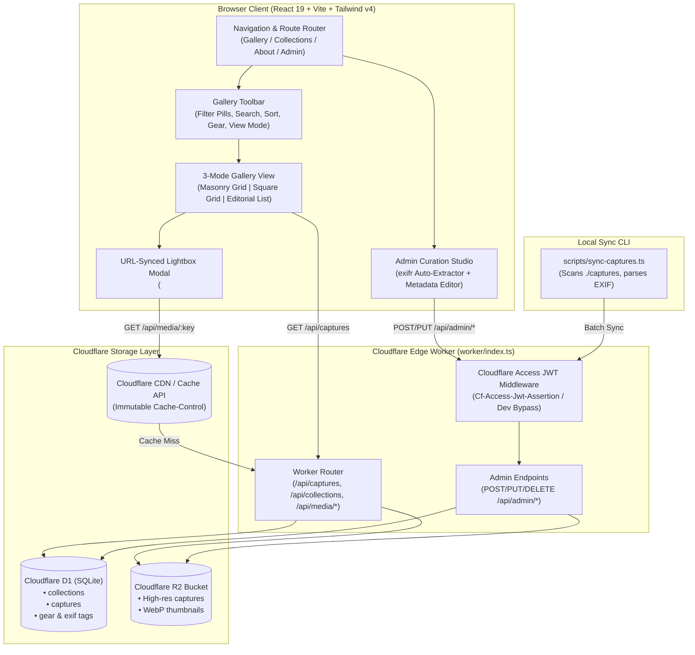
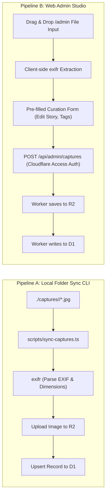

# ARCHITECTURE.md — captures-gallery

Technical architecture, data models, edge infrastructure, and implementation design for the modern contemporary **Personal Gallery (`captures-gallery`)** application.

---

## 1. Executive Summary & Vision

`captures-gallery` is an editorial-grade personal photography portfolio and visual capture repository designed with **purposeful aesthetic restraint**, sub-second global image delivery, and deep camera telemetry (EXIF).

The system pairs a responsive **Vite + React 19 + TypeScript + Tailwind CSS v4** single-page client with Cloudflare's serverless edge platform:
- **Cloudflare Workers**: High-performance HTTP API handling capture querying, metadata management, and media streaming.
- **Cloudflare D1**: Distributed SQLite relational database storing collections, captures, gear catalogs, and EXIF parameters.
- **Cloudflare R2**: Zero-egress-fee S3-compatible object storage serving original captures and WebP variants with edge cache headers.
- **Cloudflare Access (Zero Trust)**: JWT-based identity perimeter securing administrative curation and ingestion endpoints.
- **Dual Ingestion**: Seamless coexistence of a Git/local folder CLI sync (`scripts/sync-captures.ts`) and an interactive browser-based Curation Studio (`/admin`).

---

## 2. System Architecture Diagram



---

## 3. Frontend Architecture

### 3.1. Design System & Component Hierarchy

The user interface strictly adheres to [`DESIGN_SYSTEM.md`](file:///C:/Users/siraw/captures-gallery/DESIGN_SYSTEM.md), using neutral slate surfaces (`#FFFFFF`, `#F8FAFC`, `#E2E8F0`), primary slate typography (`#0F172A`, `#64748B`), and a single purposeful `#2563EB` blue accent.

```
src/
├── components/
│   ├── Navbar.tsx             # 4-item top navigation with active indicators
│   ├── GalleryToolbar.tsx     # Filter pills, search bar, sort, gear selector, view switcher
│   ├── GalleryView.tsx        # Container supporting 3 distinct layout engines
│   │   ├── MasonryGrid.tsx    # Natural aspect ratio multi-column CSS grid
│   │   ├── SquareGrid.tsx     # Architectural 1:1 contact sheet frames
│   │   └── EditorialList.tsx  # Horizontal cards with 65ch story excerpts and EXIF summary
│   ├── PhotoLightboxDialog.tsx# Accessible <dialog> with URL sync and EXIF sidebar
│   ├── CollectionsView.tsx    # Curated series cards with cover images and statements
│   ├── AboutGearView.tsx      # Photographer statement and interactive Gear & Optics Inventory
│   └── AdminStudioView.tsx    # Zero Trust uploader, EXIF extractor, and capture table
├── data/
│   └── seedCaptures.ts        # Pre-seeded editorial photography and gear inventory
├── types/
│   └── gallery.ts             # TypeScript definitions for Capture, Collection, EXIF, and Filters
├── App.tsx                    # Top-level state coordinator and routing
├── index.css                  # Tailwind v4 directives, design tokens, and typography rules
└── main.tsx                   # React root entry point
```

### 3.2. Three View Modes
1. **Aspect-Ratio Masonry Grid**:
   - Preserves natural portrait, landscape, and panorama proportions without letterboxing or cropping.
   - Built using responsive CSS columns (`columns-1 sm:columns-2 lg:columns-3 xl:columns-4 gap-6`).
2. **Uniform Square Grid**:
   - Inspired by medium-format contact sheets.
   - Standardizes presentation in `aspect-square` frames (`object-cover`) with hover reveal overlays.
3. **Editorial List**:
   - Curatorial presentation with a 240px photo thumbnail, structured metadata header, story excerpt limited to `65ch` with `text-wrap: pretty`, and an inline EXIF telemetry pill badge.

### 3.3. Photo Lightbox & URL Synchronization
- Deep-linked via URL query parameter: `?photo=<capture-slug>`.
- Native `<dialog closedby="any" aria-labelledby="lightbox-title">` element opened programmatically via `showModal()`.
- Implements the mandatory coordinate-boundary click fallback on `dialog::backdrop` to guarantee light-dismiss behavior across Safari and older browsers.
- Full keyboard trap and navigation:
  - `ArrowRight` (`→`): Next photo in current filtered sequence.
  - `ArrowLeft` (`←`): Previous photo.
  - `Escape` (`Esc`): Closes dialog and cleans URL query string without reloading.
- EXIF Telemetry Drawer displaying: Camera body, lens, focal length, aperture (`f/`), shutter speed (`s`), ISO, resolution, and location coordinates.

### 3.4. Modern Web Standards Compliance
- **LCP Optimization (`optimize-image-priority`)**:
  - The first capture in the active grid is designated the Largest Contentful Paint (LCP) candidate and receives `fetchpriority="high"` without `loading="lazy"`.
  - All subsequent captures use native `loading="lazy"` without `fetchpriority="low"`.
- **View Transitions (`same-document-transitions`)**:
  - Grid view changes and lightbox opens are wrapped in `document.startViewTransition()` where supported, with `@media (prefers-reduced-motion: reduce)` fallbacks.
  - Programmatic focus is shifted via `tabindex="-1"` after transition resolution to maintain screen reader context.
- **Typographic Legibility (`improve-text-layout-and-legibility`)**:
  - Short headings (`h1`–`h6`) use `text-wrap: balance`.
  - Paragraphs and stories use `text-wrap: pretty` to eliminate orphaned words.

---

## 4. Backend & Cloudflare Platform Architecture

### 4.1. Edge API Routes (`worker/index.ts`)

| Method | Endpoint | Access Control | Description |
| --- | --- | --- | --- |
| `GET` | `/api/captures` | Public | Lists captures with filters: `collection`, `search`, `camera`, `sort` |
| `GET` | `/api/captures/:id`| Public | Fetches detailed metadata and EXIF for a single capture |
| `GET` | `/api/collections` | Public | Returns all curated collections with capture counts and cover IDs |
| `GET` | `/api/media/:key` | Public | Streams image binaries directly from R2 with caching headers |
| `GET` | `/api/auth/session`| Public | Returns Cloudflare Access authentication status and user email |
| `POST`| `/api/admin/captures`| Zero Trust | Uploads new image to R2 and writes capture + EXIF records to D1 |
| `PUT` | `/api/admin/captures/:id` | Zero Trust | Updates capture title, story, tags, collection, or featured flag |
| `DELETE`| `/api/admin/captures/:id` | Zero Trust | Deletes capture record from D1 and deletes object from R2 |
| `POST`| `/api/admin/sync` | Zero Trust | Batch ingestion endpoint for the local CLI folder sync |

### 4.2. Cloudflare Access (Zero Trust) JWT Validation (`worker/auth.ts`)
- In production:
  - Validates `Cf-Access-Jwt-Assertion` request header.
  - Fetches and caches Cloudflare Access public keys from:
    `https://<CF_ACCESS_TEAM_DOMAIN>/cdn-cgi/access/certs`
  - Validates RS256 signature, expiration (`exp`), and audience (`aud` matching `env.CF_ACCESS_AUD`).
- In local development (`ENVIRONMENT === 'development'` or local IP/hostname):
  - Automatically bypasses authentication, injecting a development user context:
    `{ authenticated: true, email: 'dev@localhost', mode: 'development-bypass' }`.

---

## 5. Data Models & Storage Architecture

### 5.1. Relational Schema (Cloudflare D1 SQLite)

```sql
-- Collections Table
CREATE TABLE IF NOT EXISTS collections (
  id TEXT PRIMARY KEY,
  slug TEXT UNIQUE NOT NULL,
  title TEXT NOT NULL,
  description TEXT,
  cover_capture_id TEXT,
  sort_order INTEGER DEFAULT 0,
  created_at TEXT DEFAULT (datetime('now'))
);

-- Captures Table
CREATE TABLE IF NOT EXISTS captures (
  id TEXT PRIMARY KEY,
  slug TEXT UNIQUE NOT NULL,
  title TEXT NOT NULL,
  story TEXT,
  collection_slug TEXT NOT NULL,
  r2_key TEXT NOT NULL,
  image_url TEXT NOT NULL,
  width INTEGER NOT NULL,
  height INTEGER NOT NULL,
  aspect_ratio REAL NOT NULL,
  location TEXT,
  captured_at TEXT,
  camera_model TEXT,
  lens_model TEXT,
  focal_length TEXT,
  aperture TEXT,
  shutter_speed TEXT,
  iso INTEGER,
  tags_json TEXT DEFAULT '[]',
  featured INTEGER DEFAULT 0,
  created_at TEXT DEFAULT (datetime('now')),
  FOREIGN KEY (collection_slug) REFERENCES collections(slug) ON DELETE CASCADE
);

-- Query optimization indexes
CREATE INDEX IF NOT EXISTS idx_captures_collection ON captures(collection_slug);
CREATE INDEX IF NOT EXISTS idx_captures_featured ON captures(featured);
CREATE INDEX IF NOT EXISTS idx_captures_captured_at ON captures(captured_at DESC);
CREATE INDEX IF NOT EXISTS idx_captures_camera ON captures(camera_model);
```

### 5.2. Object Storage Hierarchy (Cloudflare R2)

Objects in Cloudflare R2 are organized predictably:
```
captures-gallery-media/
├── captures/
│   ├── architecture/
│   │   ├── brutalist-atrium-01.jpg
│   │   └── spiral-concrete-stairs.jpg
│   ├── street/
│   │   ├── shibuya-rain-reflections.jpg
│   │   └── night-market-neon.jpg
│   └── minimalism/
│       └── mist-over-lake-biwa.jpg
└── variants/ (optional WebP previews)
    └── 800w/
        └── brutalist-atrium-01.webp
```

When media is requested via `/api/media/:key`, the Cloudflare Worker retrieves `env.BUCKET.get(key)` and streams the body with:
```http
HTTP/1.1 200 OK
Content-Type: image/jpeg
Cache-Control: public, max-age=31536000, immutable
ETag: "<r2-etag>"
```

---

## 6. Ingestion Pipelines



### 6.1. Pipeline A: Local Folder Sync CLI (`npm run sync`)
- Scans `./captures/<collection-slug>/` for image files (`.jpg`, `.jpeg`, `.png`, `.webp`, `.avif`).
- Reads embedded EXIF parameters (`Make`, `Model`, `LensModel`, `FocalLength`, `FNumber`, `ExposureTime`, `ISO`, `DateTimeOriginal`).
- Checks if the file's hash or filename already exists in D1.
- Uploads missing files to R2 via the sync endpoint or Wrangler bindings.
- Upserts the capture row into D1.

### 6.2. Pipeline B: Web Admin Curation Studio (`/admin`)
- Accessible only through Cloudflare Access Zero Trust in production.
- Client-side drag-and-drop zone using `exifr` in the browser to instantly parse metadata upon file selection.
- Pre-fills camera specs, date, and dimensions into form fields while allowing the photographer to curate title, story narrative, collection assignment, location, and tags.
- Performs atomic upload and creation in a single transaction.

---

## 7. Local Development Resilience & Offline Emulation

To allow development and testing completely offline without pre-existing Cloudflare cloud infrastructure:
1. **Mock Storage & In-Memory / Local SQLite D1**:
   - The Vite development environment and test runners load `src/data/seedCaptures.ts` containing curated photographic series with realistic EXIF metadata and high-resolution Unsplash visual captures.
2. **Deterministic Test Suite**:
   - Vitest unit and integration tests run against mock D1 and R2 bindings in memory, verifying filtering, sorting, pagination, EXIF extraction, and Cloudflare Access JWT validation logic without external network calls.

---

## 8. Security & Accessibility Architecture

1. **Zero Trust Perimeter**: Cloudflare Access shields all mutation and administrative surfaces.
2. **Input Sanitization**: File uploads validate MIME types (`image/jpeg`, `image/png`, `image/webp`, `image/avif`) and maximum upload limits (25MB).
3. **Accessibility (WCAG AA)**:
   - All interactive controls have a minimum touch target height of `40px` (`min-h-10`).
   - Every input has an explicit programmatic label.
   - Visible focus indicators (`focus-visible:outline-2 focus-visible:outline-offset-2 focus-visible:outline-blue-600`).
   - Color is never used alone to convey state.
   - Screen reader announcements for view transitions and dialog state changes.
